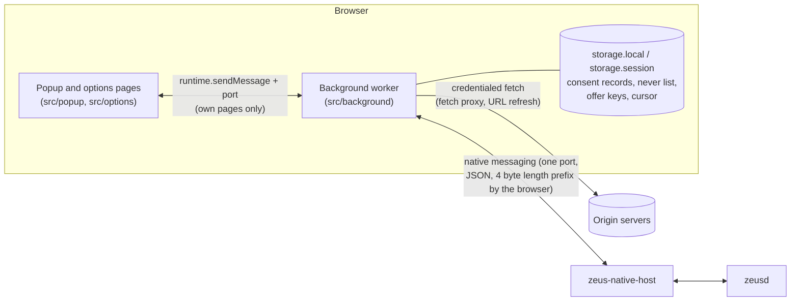
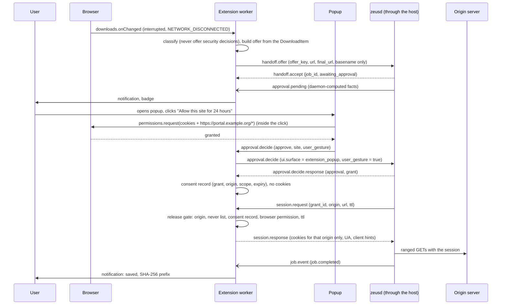

# Architecture

The extension is the **trust surface and session oracle** of Zeus. It owns one decision that nothing else may take: whether the user's session material may leave the browser. The authoritative protocol is spec 02 (`zeus/docs/spec/02-native-messaging-v1.md`); this page describes how the extension implements its side.

## Process view

## Modules (src/)

| Module                                                         | Responsibility                                                                                                                                                                                                                             |
| -------------------------------------------------------------- | ------------------------------------------------------------------------------------------------------------------------------------------------------------------------------------------------------------------------------------------ |
| `lib/platform.ts`                                              | The only place that touches `chrome` / `browser`. Narrow `ExtApi` interface, implemented by the real adapter and by the mock in `test/harness`.                                                                                            |
| `lib/protocol.ts`, `protocol.generated.ts`                     | Types generated from `schema/native-messaging.v1.schema.json`; frame construction; the inbound frame guard.                                                                                                                                |
| `lib/jsonschema.ts`                                            | A small, CSP-safe JSON Schema interpreter. Every inbound frame is validated against the normative schema files at run time (Ajv needs `eval`). Tests prove it agrees with Ajv on every spec example and on thousands of mutations of them. |
| `lib/errors.ts`, `redact.ts`, `log.ts`, `sanitize.ts`          | Error envelope, `redact_url` (normative vectors), the redacting logger, display sanitising of remote text.                                                                                                                                 |
| `background/native.ts`                                         | The link: handshake and negotiation, request correlation and timeouts, keepalive, reconnect backoff, flapping guard, idle close, malformed-frame handling. Knows nothing about downloads or sessions.                                      |
| `background/consent.ts`                                        | **The release gate** (spec 02 section 10.2).                                                                                                                                                                                               |
| `background/session.ts`                                        | `session.request` (cookies for one origin) and `url.refresh.request` (refetch and `downloads` API methods).                                                                                                                                |
| `background/fetchProxy.ts`                                     | The in-browser fetch fallback: credit-based flow control, chunking, cancel, cross-origin redirect rule.                                                                                                                                    |
| `background/downloads.ts`, `classify.ts`                       | Rescue: which interrupted downloads are offered, offer bookkeeping, withdrawal, per-origin and global offer rate limits.                                                                                                                   |
| `background/approvals.ts`, `events.ts`, `jobs.ts`, `notify.ts` | Trust surface state: pending approvals, the decision path, consent from events, the job mirror, notifications.                                                                                                                             |
| `background/state.ts`                                          | Persistent non-secret state with validated reads.                                                                                                                                                                                          |
| `background/app.ts`                                            | Composition root; registers every browser listener synchronously at worker start.                                                                                                                                                          |
| `popup/`, `options/`                                           | The human-facing pages; DOM built with `textContent` only.                                                                                                                                                                                 |

## Rescue flow

If the origin refuses the daemon (an anti-bot challenge), the daemon asks for `fetch.range` instead and the extension performs the ordinary credentialed fetch itself (spec 02 section 15.3). It never alters headers to disguise anything.

## The release gate

Every `session.request`, `url.refresh.request` and `fetch.range` passes the same function (`ConsentGate.evaluate`):

1. The origin equals the URL's origin, and is `https` (or loopback `http`).
2. The origin is not on the local never list.
3. A consent record covers the request: for `session.request` the record with the named grant; for the other two, which carry no grant id, a record for the origin whose scope matches the job (`once`), its run (`workflow`, learnt from `job.created` events) or any job (`site`).
4. The record has not expired.
5. The browser holds the optional host permission for the origin (and the cookies permission for a session release).
6. The lifetime is `min(requested, 15 minutes, remaining consent)`.

Any failure answers `consent_required` or `denied` and nothing else.

## State authority (spec 02 section 12)

| State                               | Authority here                                                                                                                                            |
| ----------------------------------- | --------------------------------------------------------------------------------------------------------------------------------------------------------- |
| Consent to release session material | **The extension.** The daemon obeys `consent_required` and `denied`.                                                                                      |
| Jobs, approvals, grants, events     | The daemon. The extension mirrors them for display and changes them only through `approval.decide`, `job.control`, `grant.revoke` and `handoff.withdraw`. |
| Cookies                             | The browser. A transient copy exists in the response frame and the daemon's memory for one lease.                                                         |
| Streams                             | The extension owns the `fetch`; the daemon owns which bytes are committed. After any loss the daemon restarts from its committed ranges.                  |

## Service-worker lifetime

The worker opens the native port at start (a connected port keeps a Chrome 105+ worker alive), pings every 20 s, reconnects with full-jitter backoff (500 ms base, 30 s cap), suspends reconnecting for 5 minutes after five connections shorter than 2 s (a broken host), and closes the port after 60 s with nothing to do (no pending offer, approval or job, no popup, no open stream). While work is pending a persistent flag (`storage.session`) and a 30-second alarm keep the connection wanted. Everything that is not secret and must survive a restart lives in `storage.local`; everything else is rebuilt by the daemon after the next `hello`.

## Known limits

- A credentialed `fetch` that the origin redirects to a CDN without CORS headers and without the user's host permission for the CDN fails with `fetch.network_error`. Extending host access across redirects needs a user gesture and is a product decision (see open issues in the specs).
- Partitioned (CHIPS) cookies are requested by partition key on a best-effort basis; the exact `topLevelSite` form accepted by each browser is unverified.
- Private-window support (`incognito` capability) is declared only when the user allowed the extension in private windows and depends on being able to identify the private cookie store.
